# NoteHub API

[](https://github.com/to1990too-eng/notehub/actions/workflows/ci.yml)


REST API для заметок с ролями, JWT-аутентификацией и пагинацией.
Демонстрирует production-подход к разработке на Python: слоистая
архитектура, миграции, тесты, статический анализ, CI/CD.

## ✨ Возможности

- 🔐 **Аутентификация**: JWT (OAuth2 Password Flow), хеширование паролей через bcrypt
- 👥 **Роли пользователей**: `user`, `moderator`, `admin` с разными правами
- 📝 **CRUD заметок**: создание, чтение, обновление, удаление
- 🌐 **Публичные и приватные заметки** с контролем доступа
- 📄 **Пагинация и поиск** по заметкам
- 📚 **Автодокументация**: Swagger UI (`/docs`) и ReDoc (`/redoc`)
- 🧪 **Тесты**: pytest с покрытием ≥82%
- ✅ **Статический анализ**: ruff + mypy
- 🐳 **Docker**: `Dockerfile` + `docker-compose.yml`
- ⚙️ **CI**: GitHub Actions на каждый push и PR

## 📸 Демонстрация

### Запуск одной командой

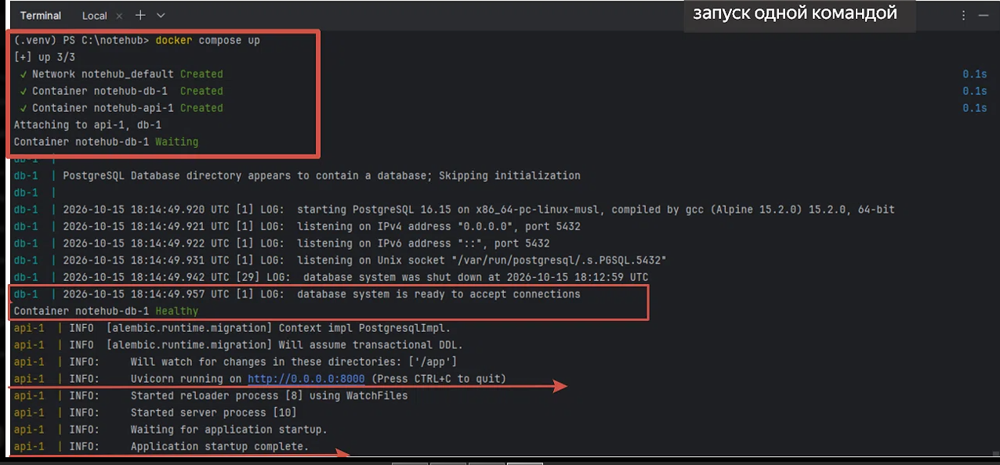

Одна команда `docker compose up` поднимает PostgreSQL, применяет миграции Alembic и стартует FastAPI.

### Swagger UI

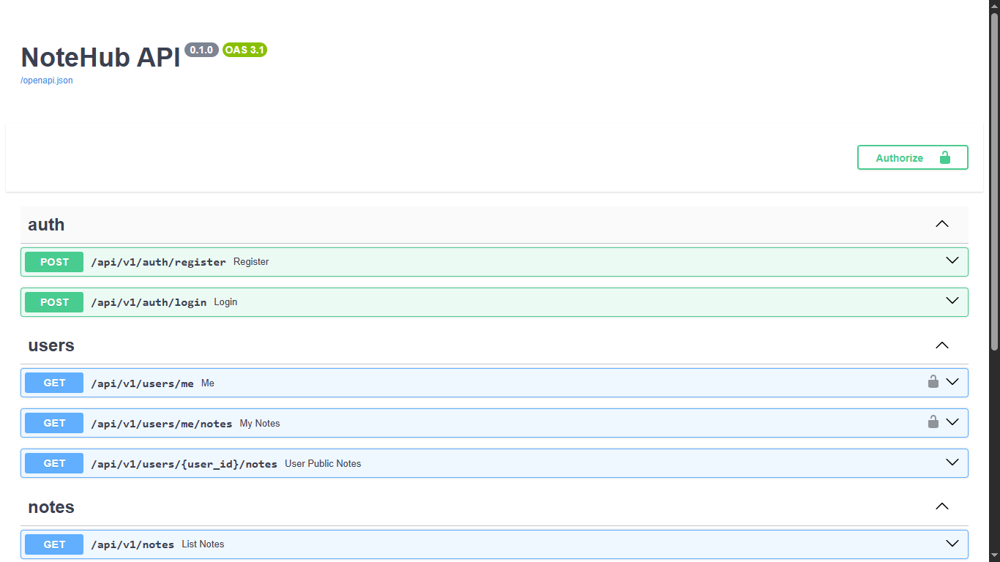
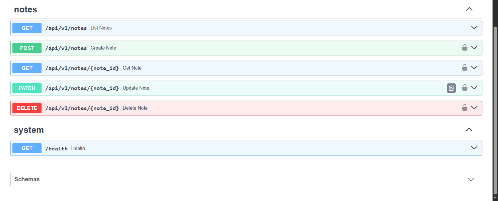

Автогенерация документации из type hints и Pydantic-схем. Все эндпоинты сгруппированы по тегам.

### Регистрация

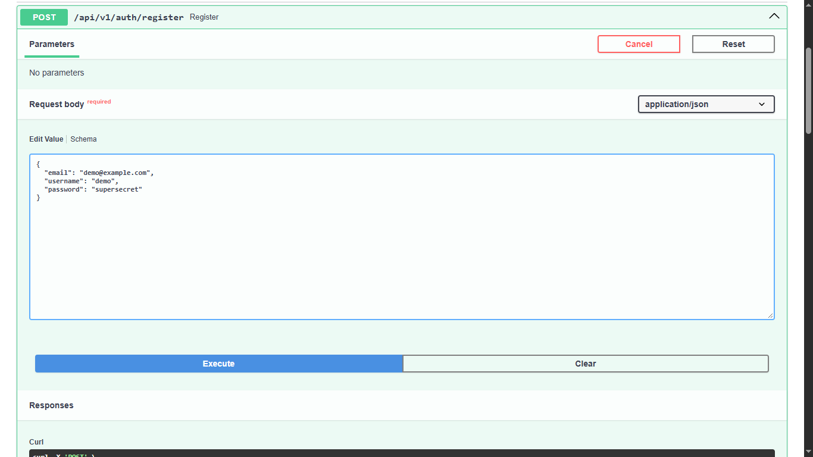
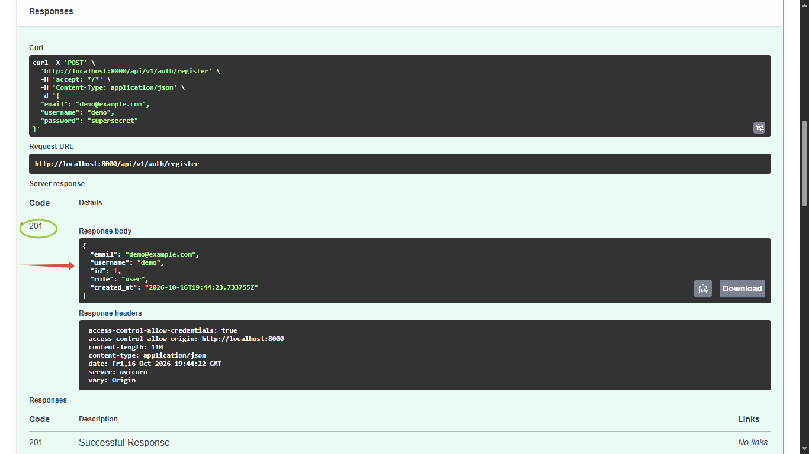

Пароль хешируется bcrypt и не возвращается в ответе. Роль по умолчанию — `user`.

### JWT-аутентификация

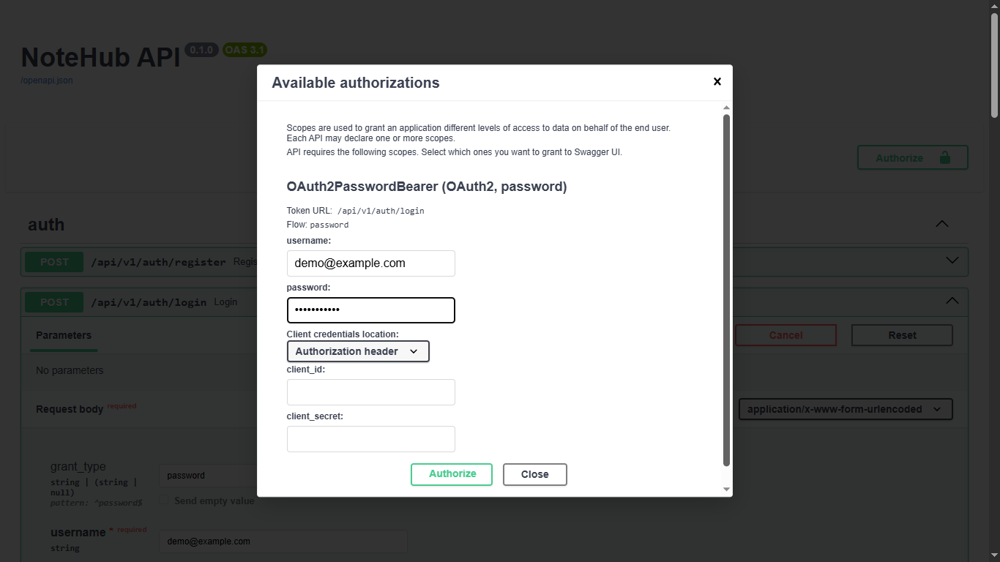
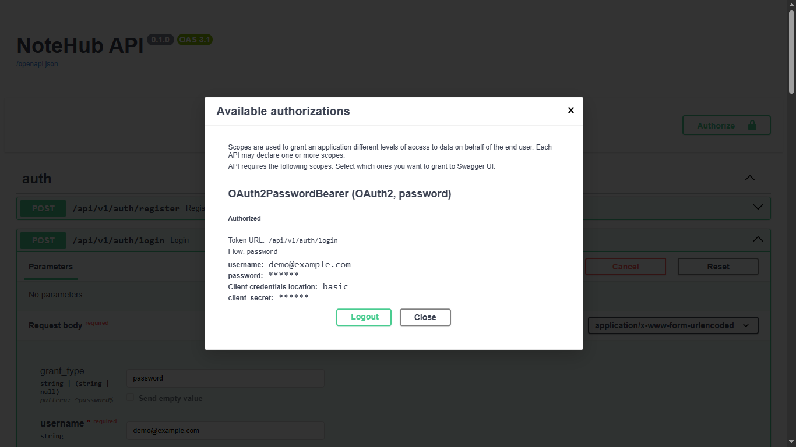

Swagger использует OAuth2 Password Flow. После ввода email и пароля он автоматически получает JWT-токен и подставляет его во все защищённые запросы.

### CRUD заметок

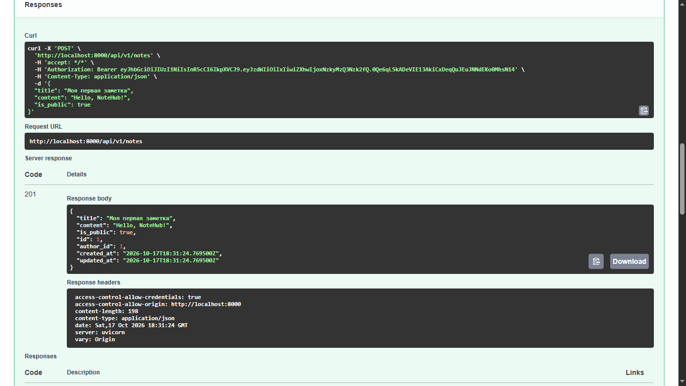
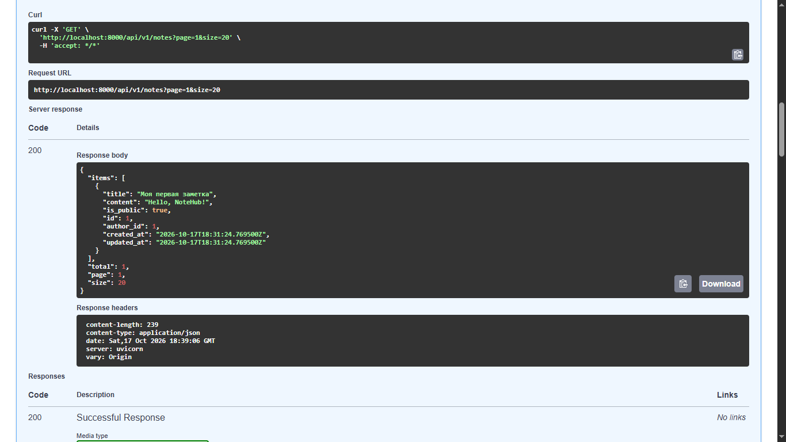

Создание защищено JWT-токеном. Список отдаётся с пагинацией (`page`, `size`) и содержит только публичные заметки.

### Тесты и покрытие

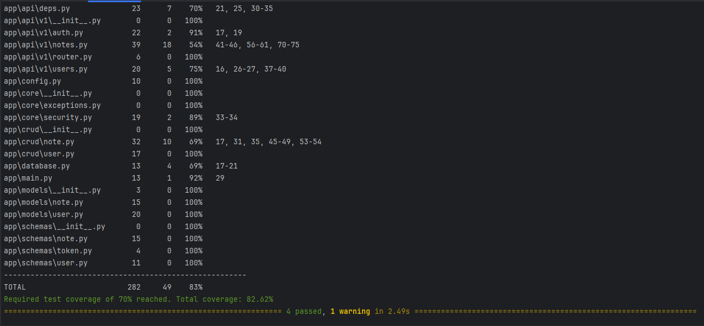

Покрытие 82% (порог в `pyproject.toml` — 70%). Проверяются: регистрация, логин, создание/чтение заметок, защита от неавторизованного доступа.

### CI на GitHub Actions

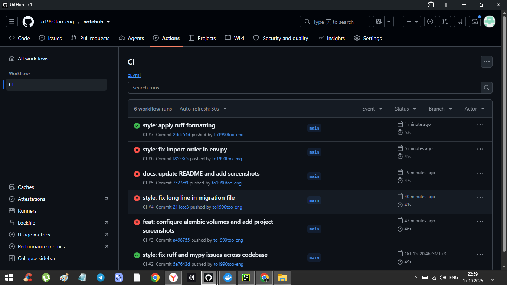

На каждый push и PR запускаются ruff, mypy, pytest и docker build.

## 🛠️ Стек

| Слой | Технология |
|---|---|
| Фреймворк | FastAPI |
| ORM | SQLAlchemy 2.0 |
| БД | PostgreSQL 16 |
| Миграции | Alembic |
| Валидация | Pydantic v2 |
| Аутентификация | python-jose, passlib[bcrypt] |
| Тесты | pytest, pytest-cov, httpx |
| Линтеры | ruff |
| Типы | mypy |
| Контейнеризация | Docker, Docker Compose |
| CI | GitHub Actions |

## 🚀 Запуск

### Через Docker (рекомендуется)

```bash
git clone https://github.com/to1990too-eng/notehub.git
cd notehub
cp .env.example .env
docker compose up -d